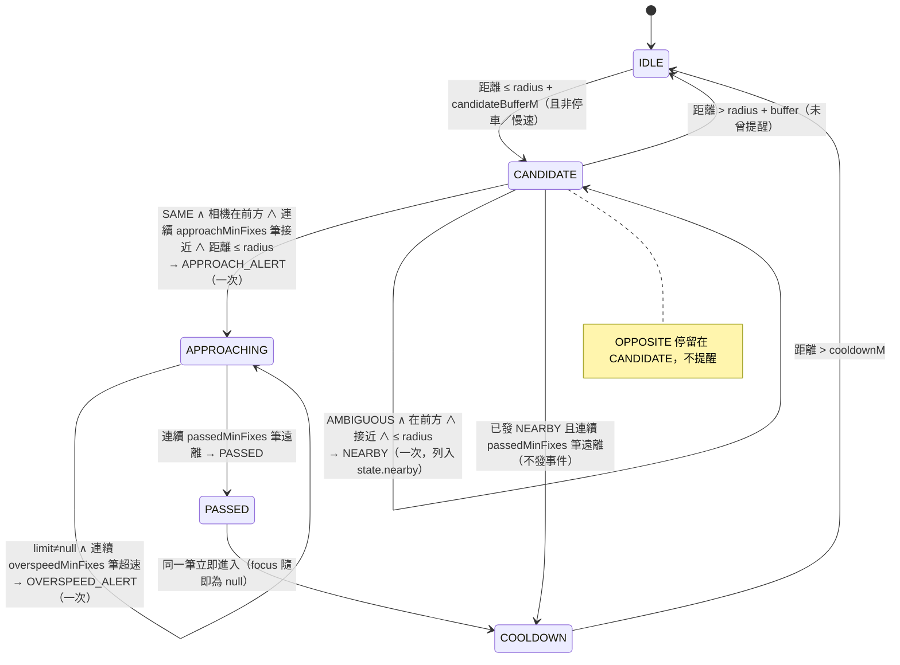
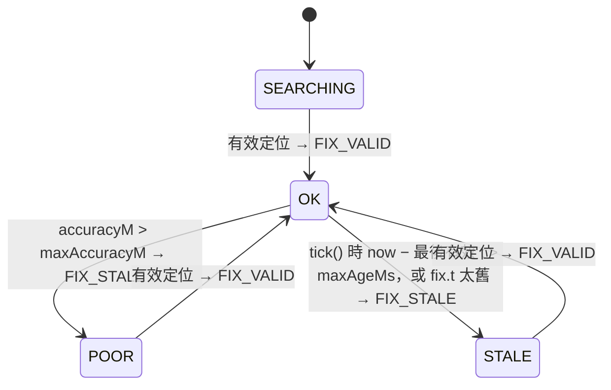

# src/engine — AlertEngine（DriveHUD V1.6，Worker A）

純 ESM、無 DOM、無 timer。真實 GPS 與模擬重播都只透過 `pushFix(fix)` 與 `tick()` 餵資料。

| 檔案 | 內容 |
|---|---|
| `alertEngine.js` | `createAlertEngine({cameras, config, now})` → `{pushFix, tick, getState, setCameras, reset, getDebug, setOptions, options}`；另匯出 `classifyRelation`、`radiusFor`、`SCAN_RADIUS_M` |
| `geo.js` | `haversineM`、`bearingDeg`、`angleDiffDeg`、`destinationPoint`、`boundingBox`、`normDeg` |
| `speech-text.js` | `approachText(distanceM, limit)`、`overspeedText(limit)`、`toChineseNumber`、`roundDistance50` |
| `__stub__/direct.js` | 測試用最小 `parseDirect`；正式版由 Worker C 提供於 `src/data/direct.js` |

模擬：`sim/player.js`（`createPlayer`、`createSimClock`）、`sim/generate-scenarios.js`（產生 `sim/scenarios/*.json` 與 `index.json`）。
測試：`node --test test/engine`（`test/engine/index.js` 讓 Node 20/22 接受目錄參數）。

## 每台相機的狀態機



全域（每筆 fix）：


每次 `gps` 改變都會發 `GPS_STATUS {status}`。停車：連續 `stationaryMinFixes` 筆 `speed < stationarySpeedMps` → `STATIONARY`；之後第一筆 `speed ≥ 門檻` → `MOVING`。

### 事件順序（同一筆 fix 內）
`GPS_STATUS` → `FIX_VALID`/`FIX_STALE` → `STATIONARY`/`MOVING` → 相機事件（依距離由近到遠）。
情境檔 `expectedEvents` 與測試比對時**忽略 `GPS_STATUS`**，其餘類型全部列出。

### state 對應
- `focus`：最近的 `APPROACHING` 相機；沒有則 `null`。UI 版面建議：`focus != null` → `approach`，否則 `normal`（`minimal` 為手動，優先）。
- `nearby`：已發 `NEARBY` 且尚未通過的 AMBIGUOUS 相機。
- `overspeed`：focus 相機連續超速計數 ≥ `overspeedMinFixes` 且目前仍超速；降速即回 false（不再重播語音）。
- `speedKmh`：定位無效（POOR/STALE/SEARCHING）時為 `null`；`speedMps` 為 null 且無前一筆可估時亦為 `null`。

## 參數影響（config.js，只讀）

| 參數 | 影響 |
|---|---|
| `alert.radiusUrbanM` / `radiusExpresswayM` / `radiusUnknownM` | 依 `camera.roadClass` 決定 APPROACH_ALERT／NEARBY 的觸發距離。語音距離 = 觸發當下距離四捨五入到 50 m，1 Hz 下通常比半徑少 0–25 m。 |
| `alert.leadTimeS` / `maxRadiusM` | V1.10：實際半徑 = max(上列固定距離, 目前車速 × leadTimeS)，上限 maxRadiusM。市區 50 km/h 仍為 200 m；快速道路 110 km/h 約 367 m（約 12 秒）。APPROACH_ALERT 帶出 `radiusM`，`state.focus.radiusM` 供畫面畫距離進度。 |
| `alert.overspeedToleranceKmh` / `overspeedRepeatS` | V1.10：可用 `engine.setOptions()` 由使用者設定覆寫。持續超速時每 overspeedRepeatS 秒發 `OVERSPEED_REPEAT`（speechText「請減速」）；config 預設 0（關閉），主畫面依設定開啟為 10 秒。 |
| `alert.candidateBufferM` | 進入 CANDIDATE 的額外距離；需 ≥ `approachMinFixes × 每秒行駛距離`，否則到達半徑時接近計數尚未湊滿、提醒會延後。150 m 足以支撐約 180 km/h。 |
| `alert.sameDirMaxDeg` / `oppositeMinDeg` | heading 與最接近 bearing 的夾角分類；中間區段為 AMBIGUOUS（例如十字路口橫向道路上的相機 → NEARBY）。 |
| `alert.bidirectionalUnknownAxisAsSame` | direct 只寫「雙向」而沒有方位的相機（全國 192 筆）是否視為同向。`true`（預設）：在前方且持續接近時發 `APPROACH_ALERT` 並可判超速；`false`：只發 `NEARBY`。地名式寫法（「往大溪方向」）不受影響，一律 AMBIGUOUS。 |
| `alert.aheadMaxDeg` | 相機方位角與 heading 夾角上限；過小時彎道上會漏報，過大時平行道路／路旁已通過的相機可能誤報。 |
| `alert.approachMinFixes` | 連續距離遞減筆數；越大越不怕抖動但越晚提醒。 |
| `alert.passedMinFixes` | 連續距離遞增筆數 → PASSED；越大越晚恢復一般版面。 |
| `alert.cooldownM` | 通過後需離開此距離才回 IDLE；在此距離內迴轉不會重新提醒。 |
| `alert.overspeedToleranceKmh` / `overspeedMinFixes` | 超速門檻與連續筆數（只在 APPROACHING 期間計算）。 |
| `fix.maxAccuracyM` | 超過即無效 → `POOR`、`speedKmh=null`、暫停判定。 |
| `fix.maxAgeMs` | `tick()` 判斷資料過期；`pushFix` 也拒收 `now − t` 超過此值的舊定位。 |
| `fix.stationarySpeedMps` / `stationaryMinFixes` | 停車判定。**低於 `stationarySpeedMps` 的單筆定位也不更新接近／遠離計數**（避免停車判定成立前的漂移造成誤判 PASSED）。 |
| `fix.minDisplacementM` | `speedMps=null` 時以位移估速；位移小於此值視為 0（1 Hz 下等於 18 km/h 以下估為 0）。 |
| `fix.headingHoldMs` | `headingDeg=null` 時沿用最後有效 heading 的時限；停車期間 heading 凍結，恢復行駛時重新起算。 |

`config.data.*`、`speech`、`ui` 不由引擎使用。

## 已知限制
1. **固定掃描半徑 2 km**（`SCAN_RADIUS_M`，非 config）：bounding box 線性預篩，2,000 台相機每筆 < 1 ms；超出 2 km 的相機狀態直接回 IDLE。
2. **heading 為 null 且超過沿用時限**時，方向關係一律 AMBIGUOUS、「在前方」檢查略過 → 只會有 NEARBY，不會有 APPROACH_ALERT。未以位移推算行進方向。
3. **低速（< `stationarySpeedMps`）不推進狀態機**：塞車以 < 5 km/h 蠕行通過相機時可能不發 PASSED，直到恢復速度。
4. 方向判定只看 heading 與 bearing，**不做道路比對（map matching）**；與相機同向的平行道路、高架上下層仍可能誤報 APPROACH_ALERT。
5. PASSED 判定只看「距離連續遞增」：APPROACHING 中轉進岔路也會被視為通過。
6. `reset()` 保留各相機的已提醒旗標與 phase（避免返回頁面後重播），只清除距離歷史；`setCameras([])` 會清除所有相機狀態（player 的 `seek` 以此做完整重置）。
7. `DENIED` 由 geolocation adapter 判斷，引擎不會產生；引擎只產生 SEARCHING／OK／POOR／STALE。
8. 區間測速（`interval`）判定邏輯與一般相機相同；V1.10 起語音改說「前方 N 公尺有區間測速」，畫面加「區間測速」標記。

## sim/player.js
```js
createPlayer({ engine, scenario, speed = 1, scheduler, clock })
// → { play(), pause(), seek(i), step(), setSpeed(v), onEvent(cb), onState(cb), onEnd(cb), index, length, playing, speed, engine }
```
- `engine` 建議傳 factory：`({ now, cameras }) => createAlertEngine({ cameras, config: CONFIG, now })`，player 會注入模擬時鐘（`now()` = 目前 fix.t），1×／4× 結果一致。
- 也可傳現成 engine 物件並同時傳 `clock`（`createSimClock()`，以 `clock.now` 建立 engine）；兩者都沒有時，player 把 fix.t 平移到 `Date.now()` 基準再餵入。
- 每步：`pushFix(fix)` + `tick()`，`onEvent(ev, index)`、`onState({index, length, fix, state})`；播完自動停止並呼叫 `onEnd`。
- `seek(i)`：清空引擎後安靜重播 0..i−1（不觸發 onEvent），再發一次 onState。
- `scheduler` 可注入 `{setTimeout, clearTimeout}` 供測試。
